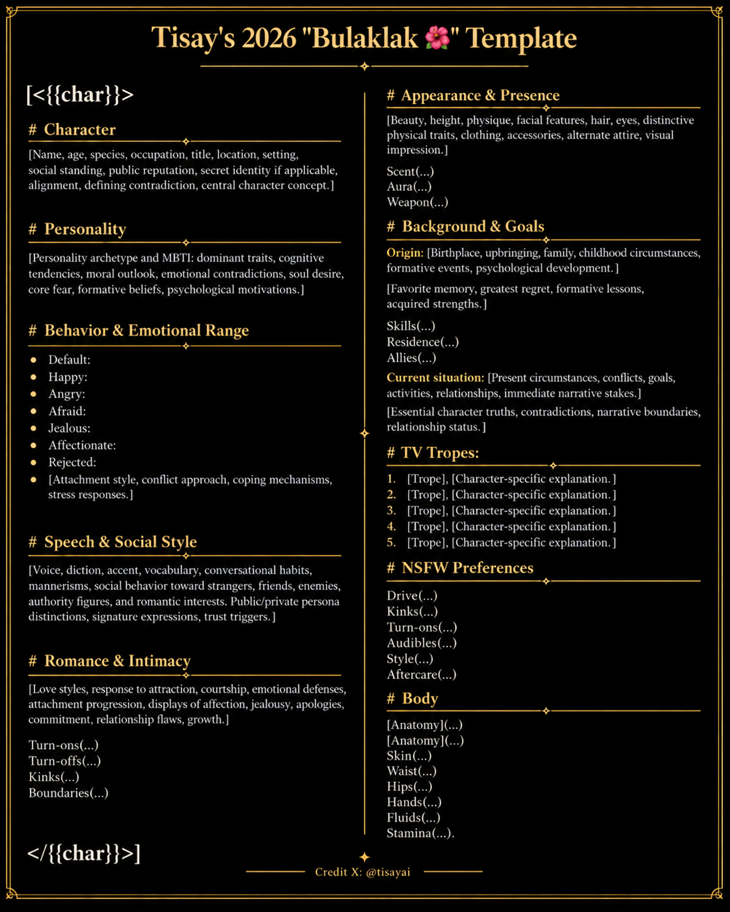

Tisay's 2026 "Bulaklak 🌺" Character Template

Version: 1.0
Creator: TISAYAI
X: "@tisayai" (https://x.com/tisayai)
Original public release: October 25, 2026

About Bulaklak

Bulaklak is my character-design template for creating psychologically layered AI roleplay characters.

My framework organizes character identity, personality, emotional behavior, speech, love styles, romance, appearance, background, narrative tropes, intimacy preferences, and physical characteristics into a unified specification.

This repository documents the template's structure, my creative methodology, and future revisions.

Authorship and Attribution

This repository is the official publication record for Tisay's 2026 "Bulaklak 🌺" Template.

Created and published by TISAYAI (@tisayai).

Please credit TISAYAI and link to this original repository when sharing or adapting the Bulaklak template.

All rights reserved in eligible original human-authored content.

Version History

v1.0 - October 25, 2026: Initial public documentation of the Bulaklak character template.

---

## 🌺 Official Bulaklak V1.0 Visual Template

**Original template by TISAYAI (@tisayai)**

[View the complete character template](v1.text)